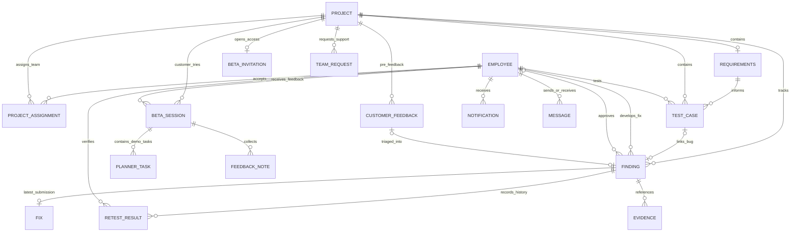

# Prototype ERD

This is a simplified logical model of the existing prototype. The app stores nested objects in browser storage, rather than relational database tables. Boxes below separate those objects so their relationships are easier to understand.

| Entity | Main information stored |
| --- | --- |
| Employee | ID, name, email, avatar, role (Manager / Developer / Tester), availability and workload. |
| Project | ID, number, name, version, team IDs, status, priority inputs, progress and UAT stage. |
| Project assignment | Project ID, employee ID, username/password, assignment key, invitation body and accepted status. Project team membership also lives in `project.team`. |
| Requirements | Uploaded document name/text and mock AI findings about missing or unclear requirements. Nested in the project’s UAT plan. |
| Test case | ID, project, assigned tester, instructions, test data, expected result, code snippet, current outcome, linked bug and tested build. |
| Finding | ID, project, optional test case, description, reproduction steps, severity, developer, status, tester verification and manager approval. Includes exploratory findings. |
| Fix | Latest submitted build, developer, change notes, code/patch and mock analysis. Nested in the finding. |
| Retest result | Outcome, build, date and optional failure details/evidence. History is nested in the finding; the latest case result is stored on the test case. The verifier is recorded on the finding. |
| Evidence | Filename/reference and, for scenario failures, an image/video blob in IndexedDB. Exploratory attachments are filenames only. |
| Beta invitation | Project key, invitation URL, recipient, subject, email draft and simulated sent date. Nested in the project. |
| Beta session | Session ID, project, stage, planner state, queued notes and unsent draft. Submitted feedback is saved as a batch with the project manager ID. |
| Planner task | Task title, notes, due date, priority and status. These belong to the mock application inside a customer session. |
| Feedback note | Type, title and details. Several notes are sent together in one feedback batch. |
| Customer feedback | Earlier sample customer feedback, review status and optional resulting finding ID. Separate from beta feedback batches. |
| Notification | Recipient employee/role, title, message, destination page and read state; some include project or feedback-batch references. |
| Message | Sender, recipient, text and timestamp. |
| Team request | Project, requester, requested employee IDs, reason, priority and approval status. |

**Reading the lines:** `||` means one, `o|` means optional, and `o{` means zero or many. Manager review, tester verification and developer ownership are roles of the same Employee entity. Customers use beta keys; the prototype does not maintain a separate customer-account table.

**Main flow:** Project → Requirements → Test cases → Findings → Fixes → Retesting → Manager approval → Beta invitation → Customer session → Feedback.

AI summaries, dashboard counts, reports and the four-panel workspace are generated views or simulations, so they do not need separate entities. UI preferences and accepted-assignment lookup maps are also omitted from the logical diagram.
